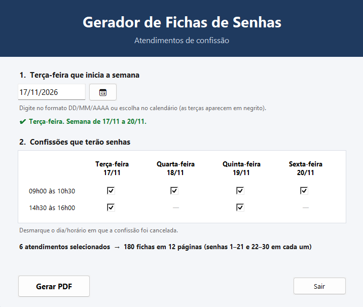
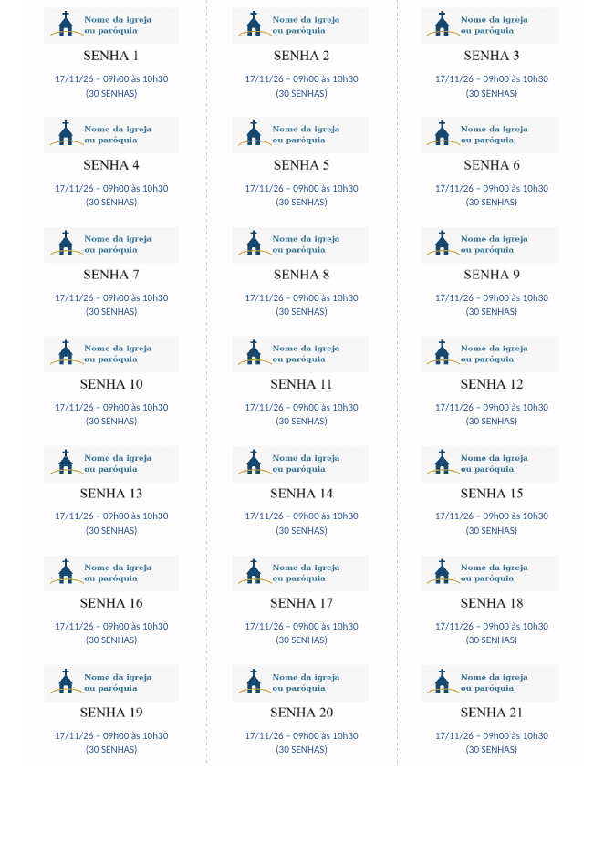

# Gerador de Fichas de Senhas


Aplicativo desktop que gera **fichas de senhas em PDF (A4)**, prontas para imprimir e recortar, para os atendimentos de confissão da semana. Basta informar a terça-feira inicial e marcar quais atendimentos vão acontecer.

> **Projeto em uso real:** criado para organizar o atendimento de confissões de uma paróquia, onde os fiéis recebem uma senha numerada na chegada. Esta é a versão genérica, sem a identidade visual da instituição, publicada como portfólio.

## Demonstração

<table>
  <tr>
    <td align="center"><b>Tela inicial</b></td>
    <td align="center"><b>PDF gerado</b></td>
  </tr>
  <tr>
    <td align="center"></td>
    <td align="center"></td>
  </tr>
</table>

*À esquerda, a tela inicial: terça-feira inicial (com calendário) e seleção dos atendimentos que vão acontecer. À direita, a primeira página do PDF gerado, com as senhas 1 a 21.*

## O problema

Cada atendimento de confissão distribui 30 senhas numeradas, com data e horário impressos, e a agenda muda a cada semana (um horário pode ser cancelado). Montar isso manualmente em um editor de texto era trabalhoso e fácil de errar. O aplicativo gera a semana inteira em segundos e já com o alinhamento correto para impressão.

## Funcionalidades

- **Tela inicial** com campo de data digitável e **calendário** para escolher o dia. As terças aparecem em negrito e a data é validada enquanto se digita.
- **Seleção por dia e horário**: desmarque a confissão que foi cancelada e o PDF só traz os atendimentos que vão acontecer. O cabeçalho mostra a data de cada dia da semana e um resumo atualiza a quantidade de fichas e páginas.
- **30 senhas por atendimento**, em 2 páginas A4: senhas 1–21 (3 colunas × 7 linhas) e 22–30 (3 colunas × 3 linhas).
- **Data e horário impressos em cada ficha**, mais a indicação `(30 SENHAS)`.
- **Linhas de corte tracejadas** entre as colunas, sem riscos nas bordas da folha.
- **Executável para Windows** com as imagens embutidas.

## Agenda configurada

| Dia | Horários |
| --- | --- |
| Terça-feira | 09h00 às 10h30 e 14h30 às 16h00 |
| Quarta-feira | 09h00 às 10h30 |
| Quinta-feira | 09h00 às 10h30 e 14h30 às 16h00 |
| Sexta-feira | 09h00 às 10h30 |

São até 6 atendimentos por semana (180 fichas em 12 páginas). A agenda fica na constante `DIAS` do código e pode ser adaptada.

## Como usar

### Opção 1: executável (Windows)

1. Baixe o `gerador-fichas-senhas.exe` na aba **Releases**. Ele é um arquivo único, com as imagens já embutidas.
2. Abra o programa e informe a terça-feira que inicia a semana.
3. Desmarque os atendimentos cancelados e clique em **Gerar PDF**.
4. Escolha onde salvar e imprima.

> Como o executável não é assinado digitalmente, o Windows pode exibir um aviso do SmartScreen. Clique em **Mais informações** e depois em **Executar assim mesmo**.

### Opção 2: código-fonte

```bash
git clone https://github.com/<seu-usuario>/gerador-fichas-senhas.git
cd gerador-fichas-senhas
py -m pip install -r requirements.txt
py gerador_fichas_senhas.py
```

Requer Python 3.10 ou superior com Tkinter (já incluso no instalador oficial para Windows).

## Personalização

As imagens de fundo ficam em `assets/` e definem o logotipo e o desenho de cada ficha:

- `fundo_senhas_1_a_21.png`: página com 21 fichas.
- `fundo_senhas_22_a_30.png`: página com 9 fichas.

Para usar outra identidade visual, substitua os dois arquivos mantendo os mesmos nomes, a proporção da página (PNG de 2224 × 3026 px) e a posição das fichas. As coordenadas usadas para posicionar o texto ficam no topo do código (`BASE_SENHA`, `CENTRO_COL_NA_IMAGEM`).

## Estrutura do projeto

```text
gerador-fichas-senhas/
├── gerador_fichas_senhas.py       # aplicativo (lógica, PDF e interface)
├── requirements.txt
├── gerador_fichas_senhas.spec     # configuração do PyInstaller
├── assets/
│   ├── fundo_senhas_1_a_21.png
│   ├── fundo_senhas_22_a_30.png
│   └── gerador-senhas.ico
└── docs/                          # imagens usadas neste README
```

## Gerar o executável

```bash
py -m pip install pyinstaller
py -m PyInstaller gerador_fichas_senhas.spec
```

O arquivo `gerador-fichas-senhas.exe` é criado em `dist/`, já com a pasta `assets/` embutida.

## Tecnologias e destaques técnicos

- **Python 3**, **Tkinter/ttk** para a interface e **ReportLab** para desenhar o PDF.
- **Pillow** para tratar as imagens de fundo: a transparência é achatada sobre branco e os tons quase brancos são removidos, o que elimina linhas fantasma na impressão.
- **Layout calculado em pontos tipográficos**: o fundo é centralizado na A4 e o texto de cada ficha é posicionado a partir de medidas feitas nos pixels do PNG.
- **Calendário próprio** em Tkinter puro, usando `calendar` e `datetime`, com validação de dia da semana.
- **Fonte com fallback**: usa Calibri e, se ela não existir, Carlito e depois Helvetica.
- Interface com validação em tempo real, resumo dinâmico e mensagens de erro em português.
- Caminhos de recursos que funcionam tanto no código-fonte quanto no executável (`sys._MEIPASS`).

## Autor

Feito por **Matheus Honorato Leite Teixeira**, estudante de Sistemas de Informação.
[LinkedIn](https://www.linkedin.com/in/matheus-honorato-lt/) · [GitHub](https://github.com/MatheusHLT)
